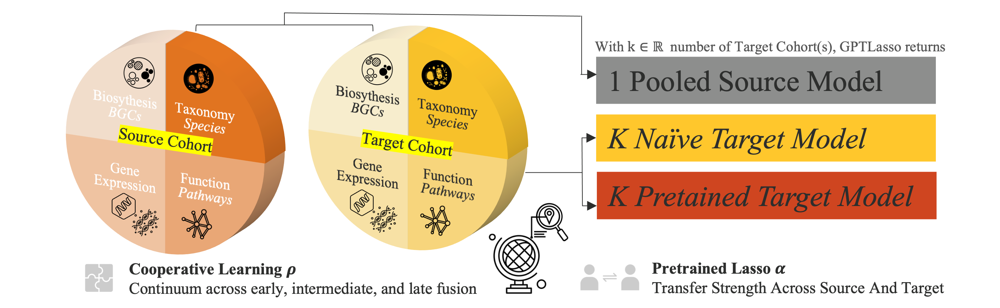
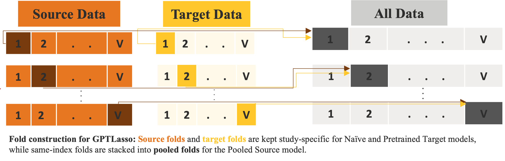

# GPTLasso

This repository houses the R package for multistudy multimodal transfer learning using **Global Pre-Training and Lasso (`GPTLasso`)**. It integrates Pretraining with Cooperative Learning to transfer multimodal knowledge from related source cohorts while maintaining target-specific behavior.



## Background

Modern biomedical prediction problems often involve multiple data modalities collected across several related cohorts, while each individual study may still be too small for stable model fitting. This project addresses that setting by combining multimodal modeling with transfer learning so that information can be shared across both studies and modalities while still allowing study-specific refinement.

The framework uses a pretrained multimodal model to learn shared structure, then fine-tunes study-level fits for improved local prediction. In simulations and motivating multi-omics applications, the goal is to improve predictive accuracy, estimation quality, and cross-study generalization relative to single-study or single-modal approaches.

**Keywords:** Transfer learning, Cooperative learning, Multistudy analysis, Multimodal Integration, Lasso, Pretraining

## Installation

You can install the development version directly from GitHub:

``` r
install.packages("devtools")
devtools::install_github("himelmallick/GPTLasso")
library(GPTLasso)
```

## Get Started

### Input containers

GPTLasso accepts either the legacy PCL-style list or a `MultiAssayExperiment`. The PCL form contains `feature_table`, `sample_metadata`, and `feature_metadata`. Its feature table is feature-by-sample; sample metadata contains `sample_id`, `study`, and `Y`; feature metadata contains `featureID` and a view column such as `featureType`. Metadata IDs must exactly match the corresponding feature-table dimnames and ordering.

For `MultiAssayExperiment` input, each named experiment is one view represented by a `SummarizedExperiment`; `colData(x)` contains `study` and `Y`; and `sampleMap(x)` maps experiment columns to primary samples. Every selected view must map exactly once to every primary sample. `assay.names` applies only to this format and must remain `NULL` for PCL input.

Training and prediction formats may be mixed because both are validated and converted to the same internal study-by-view layout.

**Note on `study` Labels:**

`gptLasso` detects study levels from `sample_metadata$study` for PCL input or `colData(x)$study` for MAE input. Unique values in observed order define the groups used for fitting and prediction summaries.

In this repository, `study` is the motivating example for handling different groups of data. In practice, users are welcome to define their own project-tailored grouping that serves the scientific or operational goal of the analysis.

### Packaged simulated data

The package contains deterministic Gaussian, binary, and survival datasets generated by `gen_simmba_multistudy()` and combined into ready-to-fit PCL objects. Each dataset contains matching training and test containers, the generating coefficients, and the simulation settings.

``` r
data(gaussianData, package = "GPTLasso")
data(binaryData, package = "GPTLasso")
data(survivalData, package = "GPTLasso")

names(gaussianData)
# [1] "x_train" "x_test" "true_betas" "settings"

gaussianData$settings[c("nsample", "rho.beta", "seed")]
```

The packaged datasets can be regenerated from `data-raw/generate_simulated_data.R`. The Gaussian tutorial data use three studies with 300, 200, and 100 samples before the 70/30 training-test split, seed 1234, and `rho.beta = 0.75`. The stronger cross-study coefficient sharing provides a stable prediction example without selecting a favorable random seed. The smaller binary and survival examples retain 60, 50, and 40 samples, `rho.beta = 0.5`, and seeds 5678 and 9012, respectively, to keep the software package compact.

### Tool

``` r
fit <- gptLasso(
    x,                                                      # PCL or MultiAssayExperiment
    assay.names = NULL,                                     # MAE assay selection; NULL for PCL
    target = NULL,                                          # Target study names or NULL for all studies
    alpha.ptlasso = 0.5,                                    # Transfer-learning level in [0, 1]
    family = c("gaussian", "binomial", "cox"),            # Response family
    type.measure = c("default", "mse", "auc", "deviance", "C"),
    rho = seq(0, 1, length = 11),                           # Multiview fusion parameter
    overall.lambda = c("lambda.1se", "lambda.min"),        # Overall-model lambda rule
    ind.lambda = c("lambda.1se", "lambda.min"),            # Individual-model lambda rule
    pre.lambda = c("lambda.1se", "lambda.min"),            # Pretrained-model lambda rule
    nfolds = 10,                                            # Number of cross-validation folds
    alpha.glmnet = 1                                        # Elastic-net mixing parameter
)
```

## Tutorial

This Gaussian example tutorial walks through packaged data inspection, model fitting, transfer-level tuning, prediction, and presentation of held-out results.

### 1. Load and inspect Gaussian multistudy multiview data

``` r
data(gaussianData, package = "GPTLasso")
x_train <- gaussianData$x_train
x_test <- gaussianData$x_test
```

Inspect the PCL layout before fitting:

``` r
names(x_train)
dim(x_train$feature_table)
colnames(x_train$sample_metadata)
table(x_train$sample_metadata$study)
table(x_train$feature_metadata$featureType)
```

Example output:

``` text
Views:
[1] "methyl"  "expr"  "protein"

Feature table:
[1] 658 420

Sample metadata columns:
[1] "subjectID" "Y" "Xbeta" "study" "sample_id"

Training study counts:
Study_1 Study_2 Study_3
    210     140      70
```

The test PCL contains 90, 60, and 30 held-out samples from `Study_1`, `Study_2`, and `Study_3`, respectively. Feature identifiers and view ordering are identical across the two splits.

An MAE can be supplied instead, with named experiments, `study` and `Y` in `colData()`, and complete one-to-one `sampleMap()` entries. For example:

``` r
library(MultiAssayExperiment)
library(SummarizedExperiment)

mae_fit <- gptLasso(
  x = an_mae,
  assay.names = "value",
  family = "gaussian",
  rho = c(0, 0.5, 1)
)
```

### 2. Fit a multistudy multiview transfer-learning model with `cv.gptLasso()` targeting all studies

``` r
set.seed(2026)

cv_fit <- cv.gptLasso(
  x = x_train,
  target = NULL,
  family = "gaussian",
  type.measure = "mse",
  rho = c(0, 0.5, 1),
  alpha.ptlasso.list = seq(0, 1, 0.25),
  overall.lambda = "lambda.min",
  ind.lambda = "lambda.1se",
  pre.lambda = "lambda.1se",
  nfolds = 5,
  verbose = TRUE
)
```

**Note on fold construction for fitting models:**

When `foldid` is not specified, the algorithm automatically constructs V folds (i.e., `nfolds = V`) by partitioning samples within each study. The same within-study fold assignments are used consistently across both the individual models and the pretrained models. To fit the cooperative learning-based overall model, samples from the same fold across studies are stacked by view to form the V-fold training datasets.



Inspect the selected alpha, rho, and performance grid:

``` r
cv_fit$alpha.ptlasso.hat
cv_fit$varying.alpha.ptlasso.hat
cv_fit$fitpre.rho
cv_fit$errpre
```

Output from the packaged Gaussian data:

``` text
$alpha.ptlasso.hat
[1] 0

$varying.alpha.ptlasso.hat
Study_1 Study_2 Study_3
   0.75    0.50    0.00

$fitpre.rho
Study_1 Study_2 Study_3
      0       0       0

$errpre
     alpha.ptlasso     mean  Study_1  Study_2  Study_3
[1,]          0.00 14.93562 11.004537 19.43213 14.37018
[2,]          0.25 15.12723 10.043373 20.57668 14.76163
[3,]          0.50 15.49732 10.777594 18.66689 17.04747
[4,]          0.75 16.50302  9.948364 18.92917 20.63154
[5,]          1.00 19.56967 12.271290 24.46806 21.96966
```

### 3. Predict on held-out data

`predict()` automatically uses `x_test$sample_metadata$Y` when `ytest` is omitted. A model trained from PCL may be predicted with MAE data, and vice versa, provided the study, view, and feature layouts match.

``` r
pred <- predict(
  cv_fit,
  xtest = x_test,
  target = NULL,
  alpha.ptlasso = NULL,
  alpha.ptlasso.type = "varying",
  overall.lambda = "lambda.min",
  ind.lambda = "lambda.1se",
  pre.lambda = "lambda.1se",
  type = "response"
)
```

Inspect the prediction object, held-out performance, and selected support:

``` r
names(pred)
pred$metrics$MSE
pred$metrics$r2
c(
  overall = length(pred$supoverall),
  individual = length(pred$supind),
  common = length(pred$suppre.common)
)
```

Output from the packaged Gaussian data:

``` text
$MSE
            mean  Study_1  Study_2  Study_3
overall 20.47751 13.94960 23.00175 24.48117
ind     19.88773 12.57063 22.46938 24.62318
pre     18.38003 11.91017 18.83185 24.39807

$r2
             mean   Study_1   Study_2   Study_3
overall 0.3999899 0.5207791 0.3876939 0.2914966
ind     0.4191348 0.5681520 0.4018657 0.2873867
pre     0.4611465 0.5908412 0.4986966 0.2939015

   overall individual     common
       112        124        112
```

`mean` is the arithmetic average of the study-level metrics, so each study receives weight `1/k`.

### 4. Tutorial: **`target` is all you need**

See `vignette("GPTLasso", package = "GPTLasso")` for target-aware workflows and additional Gaussian, binary, and Cox examples.

## Citation

If you use this repository, please cite it as:

``` text
Gao C, Arora N, Mallick H (2026). Multistudy Multimodal Pretraining and Transfer Learning.
Research abstract and open-source software for multistudy, multimodal transfer learning.
```

## Issues

For bugs, questions, or feature requests, please use the GitHub issue tracker.
